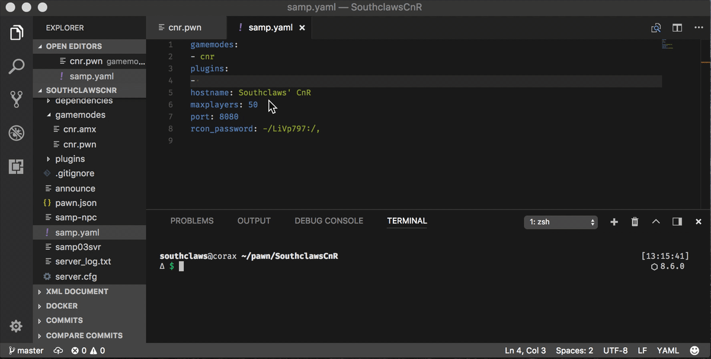

# Runtime configuration (in `pawn.json` / `pawn.yaml`)

Set server options in `runtime` or `runtimes` in your package manifest.
Sampctl generates `server.cfg` for SA:MP or `config.json` for open.mp from
those settings.

## Example

Set these fields in `pawn.json` or `pawn.yaml`.

```json
{
  "entry": "test.pwn",
  "output": "gamemodes/test.amx",
  "preset": "samp",
  "runtime": {
    "rcon_password": "change-me",
    "port": 7777,
    "hostname": "My Server",
    "maxplayers": 50
  }
}
```

```yaml
entry: test.pwn
output: gamemodes/test.amx
preset: samp
runtime:
  rcon_password: change-me
  port: 7777
  hostname: 'My Server'
  maxplayers: 50
```

Sampctl uses the build output as the gamemode when `runtime.gamemodes` is
empty or omitted.

## Building a filterscript with an existing gamemode

For a local server with a precompiled gamemode, configure the main script separately from the build output:

```json
{
  "entry": "module.pwn",
  "output": "filterscripts/module.amx",
  "preset": "openmp",
  "local": true,
  "runtime": {
    "gamemodes": ["test"],
    "filterscripts": ["module"]
  }
}
```

```yaml
entry: module.pwn
output: filterscripts/module.amx
preset: openmp
local: true
runtime:
  gamemodes:
    - test
  filterscripts:
    - module
```

Place the existing gamemode at `gamemodes/test.amx`, then run `sampctl run`.
Sampctl keeps that gamemode and builds the filterscript when its output is
missing. Use `--forceBuild` to rebuild or `--watch` to rebuild and restart
after source changes.

Keep `runtime` at the top level alongside `build`. If you build an output
outside the standard script directories, such as `module/module.amx`, load
it from your scripts or module loader.

## Plugins and components

- `runtime.plugins` and `runtime.components` list binaries to load from the
  runtime's `plugins/` and `components/` directories.
- To download a binary, add its package as a dependency:
  - `plugin://user/repo`
  - `component://user/repo` (open.mp)

After changing dependencies:

```bash
sampctl ensure
```



## Multiple runtime configs

You can define multiple entries under `runtimes` (each one should have a `name`) and select one at run time:

```bash
sampctl run <runtime-name>
```

## Files created by sampctl

Depending on what’s missing, `sampctl` may create:

- `./dependencies/` (downloaded packages)
- `./plugins/` (plugin binaries)
- `./components/` (open.mp components)
- `server.cfg` / `config.json` (generated)
- `.sampctl-runtime.json` (runtime file ownership)

See also:

- [Global configuration](global-config.md)
- [Dependencies and version pinning](dependencies.md)
- [Runtime configuration reference](runtime-configuration-reference.md)
