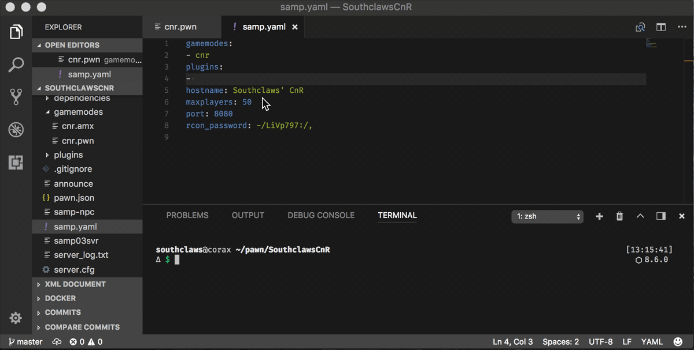

# Runtime configuration (in `pawn.json` / `pawn.yaml`)

You don’t edit `server.cfg` by hand.

Instead, `sampctl` generates:

- `server.cfg` for SA:MP
- `config.json` for open.mp

…based on the `runtime`/`runtimes` section in your `pawn.json` / `pawn.yaml`.

## Example

`pawn.json`:

```json
{
  "entry": "test.pwn",
  "output": "gamemodes/test.amx",
  "preset": "samp",
  "runtime": {
    "rcon_password": "change-me",
    "port": 7777,
    "hostname": "My Server",
    "maxplayers": 50
  }
}
```

By default, `sampctl run` runs your built output as the gamemode (you don’t need to set `gamemodes`). If `runtime.gamemodes` is explicitly configured and non-empty, that list is preserved instead.

## Building a filterscript with an existing gamemode

For a local server with a precompiled gamemode, configure the main script separately from the build output:

```json
{
  "entry": "module.pwn",
  "output": "filterscripts/module.amx",
  "preset": "openmp",
  "local": true,
  "runtime": {
    "gamemodes": ["test"],
    "filterscripts": ["module"]
  }
}
```

Place the existing gamemode at `gamemodes/test.amx`, then use `sampctl run`. The output is built when missing (or with `--forceBuild`) without replacing the configured gamemode. Use `--watch` to rebuild and restart after source changes.

Keep `runtime` at the top level, alongside `build`, not inside it. If `runtime.gamemodes` is omitted or empty, the output still becomes the gamemode. This changes the previous behavior for explicit lists, which were always overwritten.

Custom outputs such as `module/module.amx` can also be built while running an explicit gamemode; loading them is the responsibility of your configured scripts or module loader. This local-server example does not change how scripts are copied to temporary runtimes or a separate `runtime_dir`.

## Plugins and components

- `runtime.plugins` / `runtime.components` are *just the names to load* from `./plugins` or `./components`.
- To have `sampctl` *download* plugins/components for you, add them as dependencies using URL schemes:
  - `plugin://user/repo`
  - `component://user/repo` (open.mp)

After changing dependencies:

```bash
sampctl ensure
```



## Multiple runtime configs

You can define multiple entries under `runtimes` (each one should have a `name`) and select one at run time:

```bash
sampctl run <runtime-name>
```

## Files created by sampctl

Depending on what’s missing, `sampctl` may create:

- `./dependencies/` (downloaded packages)
- `./plugins/` (plugin binaries)
- `./components/` (open.mp components)
- `server.cfg` / `config.json` (generated)
- `.sampctl/` (runtime install manifest)

See also:

- [Global configuration](global-config.md)
- [Dependencies and version pinning](dependencies.md)
- [Runtime configuration reference](runtime-configuration-reference.md)
