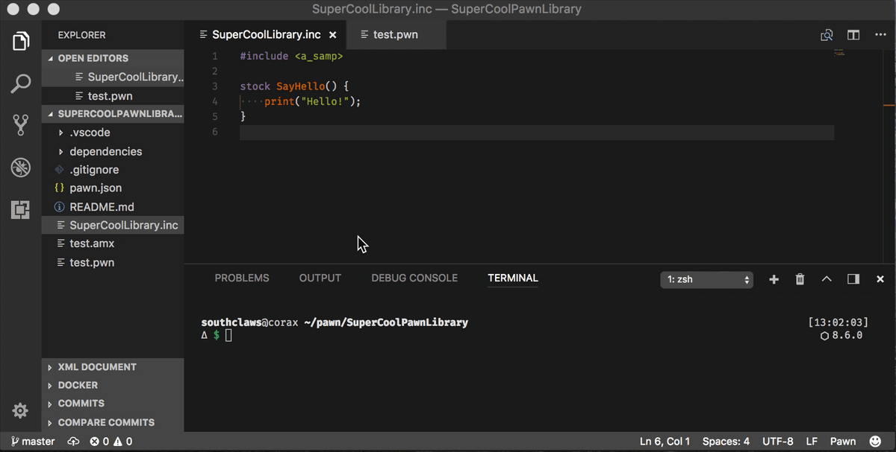

# Packages (Pawn projects)

A Pawn package is a gamemode, filterscript, or library with a `pawn.json` or
`pawn.yaml` manifest in its project directory.

## The package file (`pawn.json` / `pawn.yaml`)

A minimal example:

```json
{
  "entry": "gamemodes/main.pwn",
  "output": "gamemodes/main.amx",
  "dependencies": ["pawn-lang/samp-stdlib"]
}
```

```yaml
entry: gamemodes/main.pwn
output: gamemodes/main.amx
dependencies:
  - pawn-lang/samp-stdlib
```

Common fields you’ll see:

- `entry`: the `.pwn` file to compile
- `output`: where the `.amx` file should be written
- `runtime_dir`: directory where local runtime files should be installed
- `dependencies`: GitHub packages to download (includes/libraries)
- `overrides`: optional map from dependency declarations to replacements

To keep local server files in a separate directory, set `runtime_dir`:

```json
{
  "runtime_dir": "server"
}
```

```yaml
runtime_dir: server
```

See [Local runtime files](package-definition-reference.md#local-runtime-files)
for path resolution and build output placement.

## Install and update dependencies

Add a dependency (adds it to `pawn.json` / `pawn.yaml`):

```bash
sampctl install pawn-lang/samp-stdlib
```

Remove a dependency:

```bash
sampctl uninstall pawn-lang/samp-stdlib
```

Download/install what’s listed in your package definition:

```bash
sampctl ensure
```


Update direct dependencies that are unpinned or already use `:latest`:

```bash
sampctl ensure --update
```

Update a single dependency:

```bash
sampctl ensure --update pawn-lang/samp-stdlib
```

Update pinned tags as well:

```bash
sampctl ensure --update --force
```

By default, dependencies are cloned into `./dependencies/`.

### Project dependency overrides

Add `overrides` to your project's manifest to resolve conflicting dependency
versions. In this example, `sampctl ensure` redirects two older PawnPlus
requests to v1.5.2.

In `pawn.json`

```json
{
  "dependencies": ["github.com/IllidanS4/PawnPlus:v1.5.2"],
  "overrides": {
    "github.com/IllidanS4/PawnPlus:v1.0.0-pre4": "github.com/IllidanS4/PawnPlus:v1.5.2",
    "github.com/IllidanS4/PawnPlus:v1.4.0.1": "github.com/IllidanS4/PawnPlus:v1.5.2"
  }
}
```

In `pawn.yaml`

```yaml
dependencies:
  - "github.com/IllidanS4/PawnPlus:v1.5.2"
overrides:
  "github.com/IllidanS4/PawnPlus:v1.0.0-pre4": "github.com/IllidanS4/PawnPlus:v1.5.2"
  "github.com/IllidanS4/PawnPlus:v1.4.0.1": "github.com/IllidanS4/PawnPlus:v1.5.2"
```

- Copy the original dependency string exactly, including case, any host or
  protocol prefix, and the version.
- The root manifest's rules apply to direct, development, and transitive
  dependencies. A library's rules apply only when it's the root project.
- Project overrides take precedence over user, remote, and built-in overrides,
  in that order.

Build and run your project with the replacement before committing the override.
A library may rely on behavior from the version it requested.

See the [override rules and update behavior](package-definition-reference.md#dependency-overrides).

## Build

Compile the package:

```bash
sampctl build
```


Useful build flags:

- `--watch`: rebuild when files change
- `--dryRun`: show the build command without running it

See also: [Build configuration reference](build-configuration-reference.md)

## Run

Run the package output in a runtime (SA:MP or open.mp):

```bash
sampctl run
```

You can run in a Linux container:

```bash
sampctl run --container
```



See also:

- [Dependencies and version pinning](dependencies.md)
- [Dependency schemes (plugins, components, includes)](dependency-schemes.md)
- [Library creator guide (includes + plugins)](library-creator-guide.md)
- [Testing (watch mode, runtime modes)](testing.md)
- [Containers (Docker)](containers.md)

## Get a package from GitHub

Clone a GitHub package and ensure dependencies:

```bash
sampctl get Southclaws/formatex
```

## Templates

Templates let you run a file inside a predefined package template:

```bash
sampctl template make my-template
sampctl template build my-template test.pwn
sampctl template run my-template test.pwn
```

## Publishing (release)

If you maintain a package repo and want to create a versioned release:

```bash
sampctl release
```

This is intended for package maintainers.
