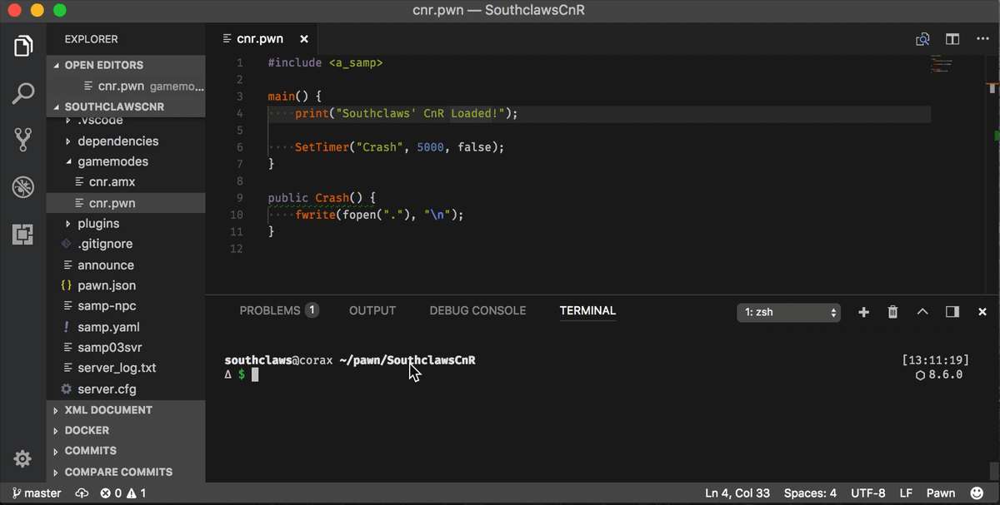

# Running a server

## Run

```bash
sampctl run
```



`sampctl run` builds the project if the output is missing, prepares the
runtime, and starts the server. It uses the compiled `.amx` as the default
gamemode when the selected runtime has no `gamemodes` configured.
Run `sampctl ensure` to install dependencies and runtime files before starting
the server.

Run in a Linux container:

```bash
sampctl run --container
```

See: [Containers (Docker)](containers.md)

## Select a runtime configuration

Pass the name of an entry under `runtimes` in `pawn.json` or `pawn.yaml`.
For example, to start a runtime named `openmp`:

```bash
sampctl run openmp
```

See [Runtime configuration](configuration.md).
